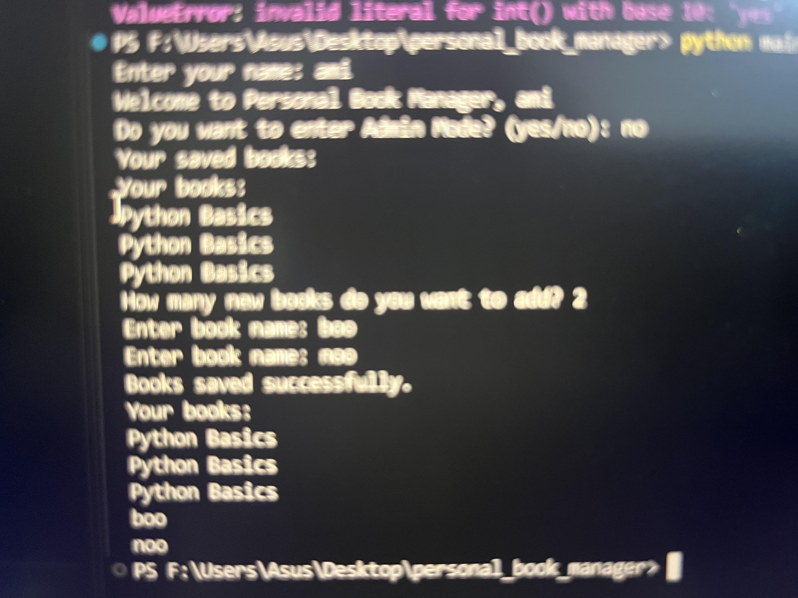

# Personal Book Manager


A simple personal book management application built with Python. It allows users to add multiple books, view their books, and save book information for future use.

## Features

- Add multiple books
- Display all saved books
- Save book information in a JSON file
- Load previously saved books
- Admin Mode with password protection

## Requirements

- Python 3
- python-dotenv

## Installation

Install the required packages using:

```bash
pip install -r requirements.txt
```

## Environment Setup

Create a file named `.env` in the project folder.

The `.env.example` file is a template that shows which environment variable is required.

The project needs the following environment variable:

`BOOK_MANAGER_ADMIN_PASSWORD`

Add the following content to your `.env` file:

```env
BOOK_MANAGER_ADMIN_PASSWORD=your_password_here
```

Replace `your_password_here` with your own password.

**Important:** Never upload your `.env` file to GitHub. The `.env.example` file should be included in the repository, but the actual `.env` file must remain private.

## Run the Program

The main program is located in `main.py`.

Run the application using:

```bash
python main.py
```

## Screenshot




##  Gifs


## Project Structure

```text
personal_book_manager/
│
├── main.py              # Main program file
├── books.py             # Book management functions
├── .gitignore           # Files ignored by Git
├── .env.example         # Example environment variables
├── requirements.txt     # Required Python packages
└── images/              # Project screenshots
```


## How It Works

1. The program starts by running `main.py`.
2. It asks the user to enter their name.
3. It loads previously saved books.
4. The user enters how many new books they want to add.
5. The program asks for the information of each book.
6. The user can view their saved books.
7. The book information is saved in `books.json`.
8. Admin Mode allows the administrator to access the protected section using a password from the `.env` file.


## Troubleshooting

### 1. FileNotFoundError

- **Meaning:** Python cannot find a required file.
- **Cause:** The file may be missing or the program may be running from the wrong folder.
- **First check:** Check whether the required files exist in the project folder.

### 2. JSONDecodeError

- **Meaning:** Python cannot read the JSON file.
- **Cause:** `books.json` may be empty or contain invalid JSON.
- **First check:** Check the contents of `books.json`.

### 3. ModuleNotFoundError

- **Meaning:** Python cannot find an imported module.
- **Cause:** The `python-dotenv` package may not be installed.
- **First check:** Check `requirements.txt` and install the packages:

```bash
pip install -r requirements.txt
```

### 4. Password Not Found

- **Meaning:** The program cannot read the admin password.
- **Cause:** The `.env` file may be missing or the variable name may be incorrect.
- **First check:** Check that `.env` exists and contains `BOOK_MANAGER_ADMIN_PASSWORD`.